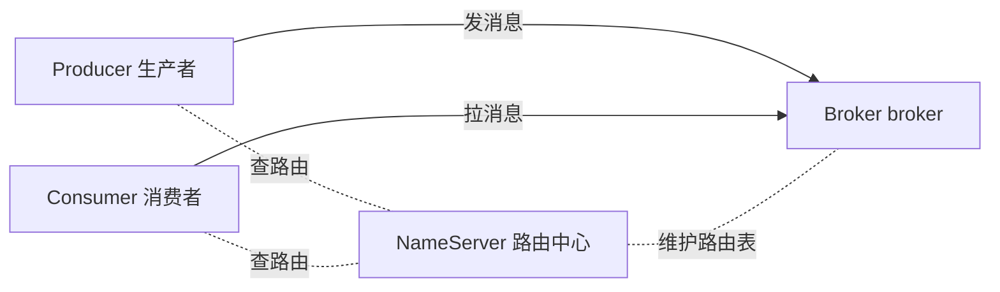
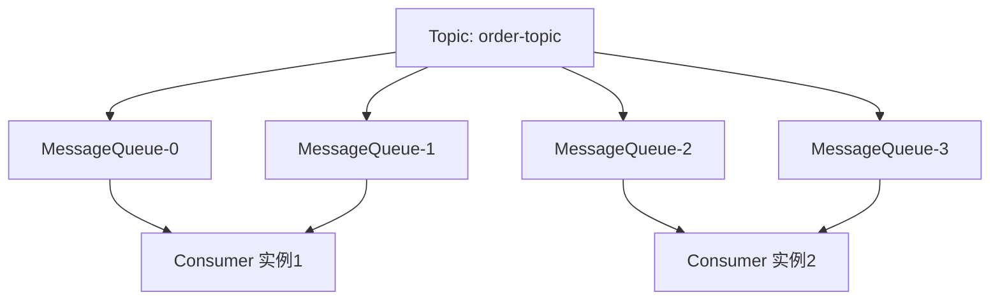

# Day 1：架构全景 + 环境搭建 + Hello World 最小收发闭环

> **班级**：初级班（必学）
> **前置**：本机已装 Docker（或 brew 装的 RocketMQ）；Maven / Java 基础
> **目标**：讲清 RocketMQ 四大角色与 Topic/MessageQueue 概念；用 Docker 一键起环境；跑通"发 1 条消息—收 1 条消息"最小闭环，证明环境通了。

---

## 一、为什么需要消息队列【理解】

先把消息队列解决的三大问题钉死，后面 15 天都是在它们上面做文章：

- **异步**：主流程不阻塞。下单后"发短信/记日志"丢给 MQ，用户立刻拿到响应。
- **解耦**：下单系统不用认识短信系统。两边都只认 MQ，加一个下游（如积分）不影响上游。
- **削峰**：秒杀 10 万 QPS，下游数据库只能扛 2 千。MQ 把流量攒住，下游按自己节奏消费。

> 一句话：消息队列是系统的"缓冲带 + 解耦层 + 异步通道"。

---

## 二、RocketMQ 四大角色【必学】



| 角色 | 干什么 | 类比 |
|:---|:---|:---|
| **Producer** | 发消息 | 寄件人 |
| **Consumer** | 收消息 | 收件人 |
| **Broker** | 存消息 + 转发（真正干活的） | 邮局/仓库 |
| **NameServer** | 路由注册中心，无状态，互不通信 | 通讯录（只查不改） |

**关键认知**：Producer/Consumer **不直接连 Broker 的 IP**，而是先问 NameServer "Topic 在哪个 Broker"，再连过去。NameServer 挂了不影响已建立连接的收发，只是不能发现新路由。

### 2.1 两个核心概念

- **Topic（主题）**：消息的一级分类，如 `order-topic`、`sms-topic`。**分类维度用 Topic，不要用 Tag 当分类。**
- **MessageQueue（队列）**：Topic 下的并行度单位。一个 Topic 默认 4 个队列。消费者实例数 ≤ 队列数才不浪费并行度（多出来的消费者分不到队列，空转）。



> 记住：**队列数 = 最大并行消费数**。这是 Day13 积压治理的命门。

---

## 三、环境搭建（二选一）【必学】

### 方式 A：Docker Compose（首选，跨平台可复现）

仓库已内置 `docker-compose.yml` + `docker/broker.conf`：

> **镜像拉不到怎么办**：若你的 Docker 镜像源代理不到 `apache/rocketmq`（拉取报 403），把 compose 里两处 `image` 改成 `rocketmqinc/rocketmq:5.3.0` 即可（内部布局一致，`broker.conf` 挂载不变）。

```bash
cd rocketmq-demo
docker compose up -d
docker compose logs broker | grep -i "boot success"   # 看到 boot success 即起好
```

- NameServer：`127.0.0.1:9876`
- Broker：`10909 / 10911 / 10912`
- `autoCreateTopicEnable=true`：发消息时 Topic 自动创建，零配置

> `broker.conf` 里 `brokerIP1=127.0.0.1` 是解决"容器内 Broker 通告容器 IP、宿主机连不上"的关键。本地单机必设。

### 方式 B：brew 原生安装（无 Docker 时）

```bash
brew install apache-rocketmq        # 若公式可用；否则下载官方 binary tarball
mqnamesrv &                         # 起 NameServer
mqbroker -n 127.0.0.1:9876 autoCreateTopicEnable=true &
```

---

## 四、Hello World 最小收发闭环【必学】

不依赖 Spring，用"裸" API 理解生命周期。完整代码见 `src/test/java/com/example/rocketmq/Day01QuickStartTest.java`。

### 4.1 生产者（发）

```java
DefaultMQProducer producer = new DefaultMQProducer("day01-producer");
producer.setNamesrvAddr("127.0.0.1:9876");
producer.start();                                      // ① 必须 start

Message msg = new Message(
    "TopicTestDay01",        // topic
    "hello",                 // tags
    "key-1",                 // keys：用于运维查询/去重
    "Hello RocketMQ".getBytes(StandardCharsets.UTF_8));// body

SendResult result = producer.send(msg);               // ② 同步发送
producer.shutdown();                                   // ③ 用完关
```

### 4.2 消费者（收）

```java
DefaultMQPushConsumer consumer = new DefaultMQPushConsumer("day01-consumer");
consumer.setNamesrvAddr("127.0.0.1:9876");
consumer.setConsumeFromWhere(ConsumeFromWhere.CONSUME_FROM_FIRST_OFFSET);
consumer.subscribe("TopicTestDay01", "*");            // 订阅 topic + tag 过滤表达式
consumer.registerMessageListener((MessageListenerConcurrently) (msgs, ctx) -> {
    for (MessageExt m : msgs) {
        System.out.println(new String(m.getBody()));  // 真正处理消息的地方
    }
    return ConsumeConcurrentlyStatus.CONSUME_SUCCESS;  // 告诉 Broker：处理成功
});
consumer.start();                                      // 后台拉取线程启动
```

### 4.3 生命周期铁律

- 生产者/消费者 `start()` 后才能用，`shutdown()` 释放连接。
- 消费者 `start()` 后**后台拉取线程**持续工作，注册监听器即可，不用自己写轮询。
- 返回 `CONSUME_SUCCESS` 才算消费完成；返回 `RECONSUME_LATER` 会重试（Day11 详讲）。

---

## 五、单元测试 Day01：跑通即证明环境通

`Day01QuickStartTest.helloWorldSendAndReceive`：
1. 起消费者（独立 group，确保从第一条消费）
2. 起生产者，发 1 条
3. `CountDownLatch` 等最多 15s，断言收到且内容正确

```bash
mvn test -Dtest=Day01QuickStartTest
```

期望：`sendStatus=SEND_OK`，`received=Hello RocketMQ`，测试绿灯。

> 若超时失败：90% 是 NameServer/Broker 没起，或 `brokerIP1` 没设对。先 `docker compose ps` 看容器状态。

---

## 六、引出：为什么要自封装 RocketMQTemplate

Day1 用裸 API 是为了看清底层。真实项目里每次都写 `new Producer → start → send → shutdown` 太啰嗦。下一步我们会用 `RocketMQConfig`（已在工程模板里）把 `DefaultMQProducer` 做成 Spring Bean 统一注入，并封装一个 `RocketMQTemplate` 发送便利方法——Day2 见。

---

## 七、核对清单

- [ ] ✅ 能画四大角色关系图（Producer/Consumer/Broker/NameServer）
- [ ] ✅ 能解释 Topic 与 MessageQueue 的区别、队列数=并行度
- [ ] ✅ `docker compose up -d` 起环境，`boot success` 出现
- [ ] ✅ Day01 测试绿灯：发 1 条、收 1 条，内容正确
- [ ] ✅ 口述：NameServer 挂了，已建连的收发还通不通？（答：通，只是不能发现新路由）
