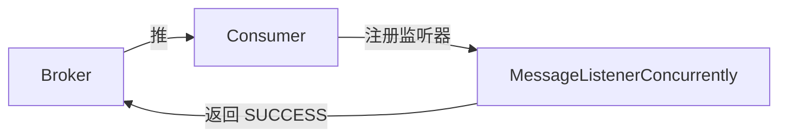
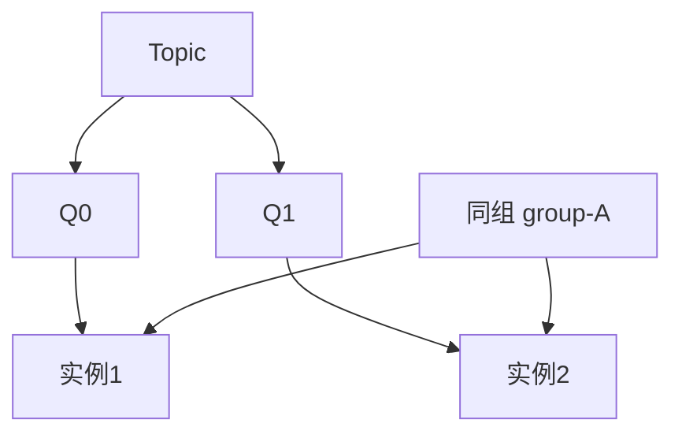

# Day 3：第一个消费者 + 消费组 + 集群模式

> **班级**：初级班（必学）
> **前置**：Day2 生产者会发了
> **目标**：会用 `DefaultMQPushConsumer` + `MessageListenerConcurrently`；理解消费组集群分摊；读懂 `ConsumeConcurrentlyStatus`；认识 `Message` 结构。

---

## 一、消费者怎么"被动"收消息【必学】



`DefaultMQPushConsumer` 的"Push"不是 Broker 主动推 HTTP，而是**客户端长轮询拉**，有消息立刻回调你的监听器。你只管写"收到后干什么"，不用自己写轮询。

---

## 二、最小消费者（QuickConsumerService）【必学】

```java
DefaultMQPushConsumer consumer = new DefaultMQPushConsumer(group);
consumer.setNamesrvAddr("127.0.0.1:9876");
consumer.setConsumeFromWhere(ConsumeFromWhere.CONSUME_FROM_FIRST_OFFSET);
consumer.subscribe(topic, "*");                 // 订阅 topic + tag 表达式
consumer.registerMessageListener((MessageListenerConcurrently) (msgs, ctx) -> {
    for (MessageExt m : msgs) {
        System.out.println(new String(m.getBody()));
    }
    return ConsumeConcurrentlyStatus.CONSUME_SUCCESS;  // 告诉 Broker：处理完了
});
consumer.start();   // 后台拉取线程启动
```

---

## 三、消费组（Consumer Group）【必学】

消费组是 RocketMQ 的**负载均衡单位**：

- **同组多实例**：队列被分摊，一条消息只给组内一个实例（集群模式，默认）
- **不同组**：每条消息都各自消费一份（广播给不同业务）



> 队列数 = 并行度。4 个队列起 8 个同组实例，多 4 个分不到队列，空转。

---

## 四、返回值：SUCCESS 还是 RECONSUME_LATER【必学】

监听器返回两个状态之一：

- `CONSUME_SUCCESS`：处理成功，Broker 推进 offset
- `RECONSUME_LATER`：本次失败，Broker 稍后重试（Day11 详讲重试与死信）

**返回 SUCCESS 才算这条消息消费完。** 如果业务处理抛异常但返回了 SUCCESS，消息会被"假成功"跳过——这是常见 bug。

---

## 五、Message 结构【理解】

```java
m.getTopic();     // 主题
m.getTags();      // 标签
m.getKeys();      // 业务主键
m.getBody();      // 消息体（字节）
m.getMsgId();     // 消息 ID
```

---

## 六、单元测试 Day03

`Day03ConsumeTest`：Day2 的 `SyncProducerService` 发一条，`QuickConsumerService` 收，CountDownLatch 断言收到且内容正确。

```bash
mvn test -Dtest=Day03ConsumeTest
```

---

## 七、核对清单

- [ ] ✅ 能说清 Push 本质是"客户端长轮询拉"
- [ ] ✅ 能画"同组分摊、不同组各一份"
- [ ] ✅ 知道队列数 = 并行度，实例数超过队列数会空转
- [ ] ✅ 知道返回 SUCCESS 才算消费完，异常不能乱返回 SUCCESS
- [ ] ✅ Day03 测试绿灯
