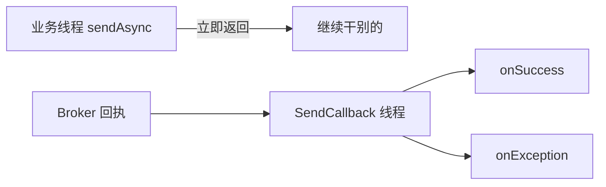

# Day 4：发送三兄弟——同步 / 异步 / 单向

> **班级**：初级班（必学）
> **前置**：Day2 同步发送已会
> **目标**：分清三种发送方式的适用场景；会用异步 `SendCallback` 与单向 `sendOneway`。

---

## 一、三兄弟一句话区别【必学】

| 方式 | 方法 | 等不等结果 | 可靠性 | 吞吐量 | 典型场景 |
|:---|:---|:---|:---|:---|:---|
| 同步 | `send(msg)` | 等 | 高 | 中 | 下单、扣库存（要确认） |
| 异步 | `send(msg, callback)` | 不等，回调通知 | 高 | 高 | 高并发发消息，不阻塞主线程 |
| 单向 | `sendOneway(msg)` | 不等也不管 | 低（可能丢） | 最高 | 日志、埋点（丢了无所谓） |

---

## 二、异步发送：高吞吐的关键【必学】

```java
producer.send(msg, new SendCallback() {
    @Override
    public void onSuccess(SendResult result) { /* 发成功了 */ }
    @Override
    public void onException(Throwable e) { /* 失败了，自己补偿 */ }
});
```

异步不阻塞当前线程，Broker 回执后回调 `onSuccess` / `onException`。**回调在哪个线程？** RocketMQ 内部有发送回调线程池，不是业务线程——所以回调里别做重活，且异常处理必须自己写（不会抛到业务代码）。



---

## 三、单向发送：能丢的场景才用【理解】

```java
producer.sendOneway(msg);   // 无返回值，不等也不回调
```

不发不收确认，最快。只用于"丢了不影响业务"的场景（访问日志、 metrics）。**别拿它发订单。**

---

## 四、代码模板（SendModeService）【必学】

见 `src/main/java/com/example/rocketmq/service/SendModeService.java`，三个方法一一对应。

---

## 五、单元测试 Day04

- `asyncSendInvokesCallback`：异步发送，CountDownLatch 等回调触发，断言拿到 `SendResult`
- `onewaySendDoesNotThrow`：单向发送不抛异常

```bash
mvn test -Dtest=Day04SendModeTest
```

---

## 六、核对清单

- [ ] ✅ 能背三兄弟的"等结果 / 可靠性 / 吞吐"差异
- [ ] ✅ 知道异步回调在独立线程，异常要自己处理
- [ ] ✅ 知道单向发送会丢，只用于日志类场景
- [ ] ✅ Day04 测试绿灯
