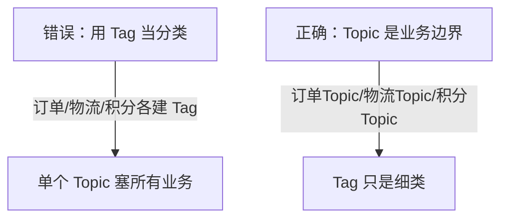

# Day 5：Tag 过滤 + Keys + 消息属性透传

> **班级**：初级班（必学）
> **前置**：Day3 消费者会写了
> **目标**：会用 `topic:tag` 二级过滤；理解 `keys` 用于溯源；会用 `putUserProperty` 透传业务字段；知道 Tag 不是分类维度。

---

## 一、Tag：Topic 下的二级过滤【必学】

同一 Topic 下用 Tag 区分细类，消费者用 `subscribe` 表达式筛选：

```java
consumer.subscribe("TopicOrder", "pay || refund");  // 只收 pay 和 refund
consumer.subscribe("TopicOrder", "*");               // 全收
consumer.subscribe("TopicOrder", "pay");             // 只收 pay
```

> 过滤在服务端做，不需要的 Tag 根本不推给消费者，省带宽。

---

## 二、Keys：给消息一个业务身份证【必学】

```java
new Message("TopicOrder", "pay", "ORDER-9001", body);  // 第三个参数就是 keys
```

`keys` 是业务主键（订单号等），**用于运维在 Dashboard / `mqadmin` 里按 keys 查这条消息去哪了**。强烈建议每条消息都设。

---

## 三、putUserProperty：透传业务字段【必学】

```java
Message msg = new Message(topic, tags, keys, body);
msg.putUserProperty("traceId", traceId);
msg.putUserProperty("userId", "U-888");
// 消费端
String traceId = msg.getUserProperty("traceId");
```

常用于透传 `traceId`（链路追踪）、`userId` 等，避免塞进 body 解析。

---

## 四、Tag 误用陷阱【必学】



**Topic 是一级业务边界（订单 / 短信 / 审计各一个 Topic）；Tag 只是 Topic 内的细分（订单下的 pay/refund）。** 不要用几十个 Tag 把不同业务塞进一个 Topic——那样队列、权限、扩容全都搅在一起。

---

## 五、代码模板（TagFilterService）【必学】

见 `src/main/java/com/example/rocketmq/service/TagFilterService.java`，`sendWithTag` 支持传 `Map` 属性。

---

## 六、单元测试 Day05

`Day05TagFilterTest`：发 tagA/tagB/tagC 三条，消费者只订阅 `tagA || tagB`，断言只收到前两条。

```bash
mvn test -Dtest=Day05TagFilterTest
```

---

## 七、核对清单

- [ ] ✅ 会用 `subscribe(topic, "tagA || tagB")`
- [ ] ✅ 每条消息都设 `keys`（业务主键）
- [ ] ✅ 会用 `putUserProperty` / `getUserProperty` 透传字段
- [ ] ✅ 知道 Topic 是业务边界、Tag 是细类，不乱用 Tag 分类
- [ ] ✅ Day05 测试绿灯
