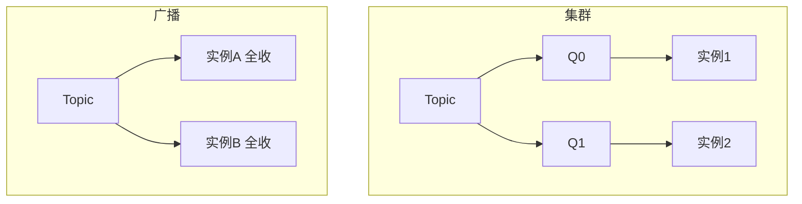

# Day 6：集群模式 vs 广播模式

> **班级**：初级班（理解）
> **前置**：Day3 消费组已懂
> **目标**：分清集群模式（默认，分摊）与广播模式（每人一份）；知道两者消费进度存储位置不同。

---

## 一、两种模式一句话【必学】

- **集群模式（默认）**：同组实例**分摊**队列，一条消息只给组内一个实例。用于"提高吞吐"。
- **广播模式（BROADCASTING）**：同组**每个**实例都收到全量消息。用于"多节点各自干一遍"。



---

## 二、消费进度（offset）存在哪【理解】

这是两者最隐蔽的区别：

| 模式 | offset 存哪 | 含义 |
|:---|:---|:---|
| 集群 | Broker（`%RETRY%group` 之类） | 组内共享进度，实例挂了别的顶上接着消费 |
| 广播 | **消费者本地** | 每个实例自己记自己消费到哪 |

> 后果：广播模式下，一个实例重启后**从自己本地进度继续**；集群模式下，队列被重分配后，新持有者从 Broker 上的组进度继续。

---

## 三、什么时候用广播【必学】

广播的典型场景：**多节点本地缓存刷新**。比如 3 台应用服务器都缓存了"商品配置"，配置更新时发一条广播消息，3 台各自刷新自己的本地缓存。

不适合广播的：订单处理（同组应分摊，不能每家都处理一遍导致重复扣款）。

---

## 四、代码模板（BroadcastService）【必学】

```java
consumer.setMessageModel(MessageModel.BROADCASTING);  // 唯一一行差别
consumer.subscribe(topic, "*");
```

集群模式不用设（默认就是 `CLUSTERING`）。

---

## 五、单元测试 Day06

`Day06BroadcastTest`：同组起两个广播实例，发 1 条，断言两个实例都收到。

```bash
mvn test -Dtest=Day06BroadcastTest
```

---

## 六、核对清单

- [ ] ✅ 能说清集群"分摊"、广播"每人一份"
- [ ] ✅ 知道集群 offset 存 Broker、广播 offset 存本地
- [ ] ✅ 能举例广播模式适用场景（本地缓存刷新）
- [ ] ✅ Day06 测试绿灯
