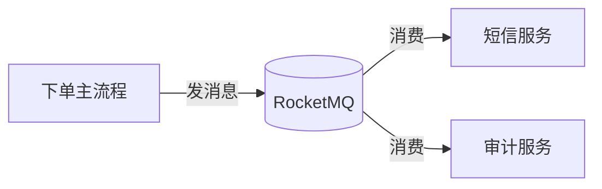

# Day 7：普通消息实战——下单异步解耦

> **班级**：初级班（必学）
> **前置**：Day2~6 基础全过
> **目标**：用消息队列把"下单主流程"和"短信通知 / 审计日志"解耦，主流程不阻塞；引出可靠性问题。

---

## 一、痛点：下单接口在"打电话"【必学】

没有 MQ 时，下单接口往往这样：

```
写订单库 → 调短信服务 → 调审计服务 → 返回用户
```

短信服务抖一下，用户下单就转圈；审计服务升级，下单代码得改。这就是 Day1 说的"互相打电话"。

---

## 二、用 MQ 改成"寄信"【必学】



下单只做两件事：写订单库 + 发消息。短信、审计各自消费，互不影响、可独立扩容。

---

## 三、代码怎么写（OrderNotifyService）【必学】

```java
public void onOrderPaid(String orderId, String userId) throws Exception {
    // 短信通知：丢了最多用户没收到短信，单向即可
    producer.sendOneway(new Message(TOPIC_NOTIFY, "sms", orderId, ...));
    // 审计日志：不能丢，同步确认
    producer.send(new Message(TOPIC_AUDIT, "log", orderId, ...));
}
```

- 短信用**单向**（丢了可接受，换 Day4 知识）
- 审计用**同步**（审计不能丢，必须确认落库）

> 同一个业务里，不同下游按"能不能丢"选不同发送方式——这就是 Day4 三兄弟的真实用法。

---

## 四、主流程不阻塞【必学】

下单接口发完消息立刻返回用户"支付成功"，短信和审计在后台慢慢消费。用户感知的响应时间 = 写库 + 发消息，不再被下游拖累。

---

## 五、埋下的雷：可靠性【理解】

今天只解决"解耦 + 不阻塞"。但三个问题没解决，留到中级班：

1. 消息发了，消费者挂了没消费 → 丢？
2. 同一条消息被重试投递两次 → 短信发两遍？
3. Broker 宕机 → 消息还在吗？

Day11（幂等）、Day12（事务）、Day14（高可用）会逐一解决。

---

## 六、单元测试 Day07

`Day07OrderNotifyTest`：调用 `onOrderPaid`，起两个消费者分别收通知和审计，断言都收到。

```bash
mvn test -Dtest=Day07OrderNotifyTest
```

---

## 七、核对清单

- [ ] ✅ 能画出"下单→发消息→多下游消费"的解耦图
- [ ] ✅ 知道按"能不能丢"给不同下游选发送方式
- [ ] ✅ 知道主流程响应时间 = 写库 + 发消息，不被下游拖累
- [ ] ✅ 能说出今天埋下的三个可靠性问题（对应 Day11/12/14）
- [ ] ✅ Day07 测试绿灯
