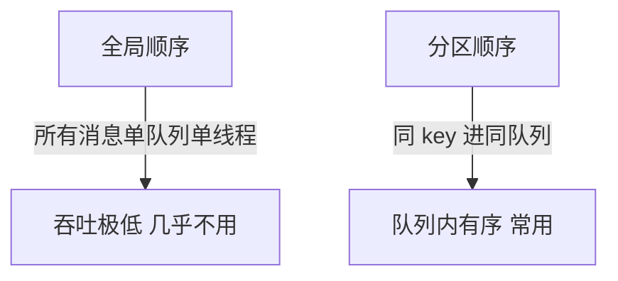

# Day 8：顺序消息（分区有序）

> **班级**：中级班（必学）
> **前置**：Day3 消费者、Day5 Tag
> **目标**：理解全局顺序 vs 分区顺序；会用 `MessageQueueSelector` 把同 key 路由到固定队列；用 `MessageListenerOrderly` 顺序消费。

---

## 一、全局顺序 vs 分区顺序【必学】



RocketMQ **只保证分区顺序**：同一个 MessageQueue 里的消息，按写入顺序被消费。要做到"某业务有序"，就把它的消息都送进同一个队列。

> 全局顺序 = 整个 Topic 一个队列一个消费者，吞吐崩，基本不用。生产里要的是"订单维度有序"，即分区顺序。

---

## 二、MessageQueueSelector：把同 key 路由到固定队列【必学】

```java
producer.send(msg, new MessageQueueSelector() {
    @Override
    public MessageQueue select(List<MessageQueue> mqs, Message msg, Object arg) {
        int h = arg.hashCode();
        return mqs.get(Math.floorMod(h, mqs.size()));   // 按订单号取模选队列
    }
}, orderId);   // arg = orderId
```

`arg` 就是路由 key（订单号）。相同 `orderId` 永远算出同一个队列 → 它的所有状态事件进同一队列 → 有序。

---

## 三、顺序消费：MessageListenerOrderly【必学】

```java
consumer.registerMessageListener((MessageListenerOrderly) (msgs, context) -> {
    for (MessageExt m : msgs) { /* 处理 */ }
    return ConsumeOrderlyStatus.SUCCESS;
});
```

`MessageListenerOrderly` 会对**单个队列加锁**串行消费，保证顺序。返回 `SUCCESS` 提交；返回 `SUSPEND_CURRENT_QUEUE_A_IN_SECONDLY` 会重试（暂停该队列）。

---

## 四、实战：订单状态流转【必学】

订单 `CREATED → PAID → SHIPPED` 必须按序。按 `orderId` 路由，三个事件进同一队列，顺序消费，不会出现"先收到 SHIPPED 再收到 PAID"的乱序。

---

## 五、代码模板（OrderSequenceService）【必学】

见 `src/main/java/com/example/rocketmq/service/OrderSequenceService.java`，`sendOrderEvent(topic, orderId, status)`。

---

## 六、单元测试 Day08

`Day08SequenceTest`：同一 `orderId` 发 CREATED/PAID/SHIPPED，用 `MessageListenerOrderly` 消费，断言收到顺序严格为 CREATED→PAID→SHIPPED。

```bash
mvn test -Dtest=Day08SequenceTest
```

---

## 七、核对清单

- [ ] ✅ 能解释"RocketMQ 只保证分区顺序"
- [ ] ✅ 会用 MessageQueueSelector 按 key 路由固定队列
- [ ] ✅ 知道顺序消费用 MessageListenerOrderly（队列加锁串行）
- [ ] ✅ Day08 测试绿灯，顺序严格正确
