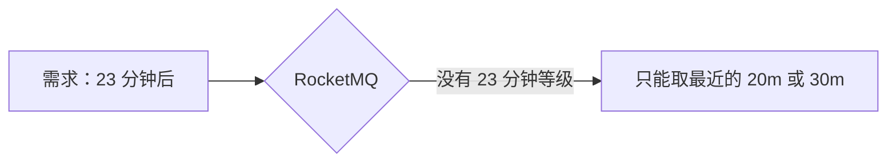

# Day 9：延迟消息

> **班级**：中级班（必学）
> **前置**：Day2 生产者
> **目标**：会用 `setDelayTimeLevel` 发延迟消息；知道 18 个固定等级；理解"不能自定义任意时间"的坑；了解替代方案。

---

## 一、18 个延迟等级【必学】

RocketMQ 的延迟不是"传个毫秒数"，而是**固定 18 个等级**：

```
1:1s   2:5s    3:10s   4:30s   5:1m   6:2m   7:3m   8:4m   9:5m   10:6m
11:7m  12:8m   13:9m   14:10m  15:20m 16:30m 17:1h  18:2h
```

用法：

```java
Message msg = new Message(topic, tags, body);
msg.setDelayTimeLevel(16);   // 30 分钟后才可被消费
producer.send(msg);
```

> 消息发到 Broker 后，在内部"躲"对应时长，**到点才对消费者可见**。

---

## 二、最大的坑：不能自定义任意时间【必学】



你没法写"延迟 23 分钟"。只能从 18 个等级里**取最近的一个**（20m 或 30m）。精度由等级表决定。

> 设计延迟业务时，先对照等级表，要么选最接近的，要么换方案。

---

## 三、替代方案：任意精度延迟【理解】

需要"任意分钟/任意时刻"的延迟怎么办？

- **定时任务**：扫表里"该执行的记录"，到点处理（简单，量小可用）
- **时间轮（HashedWheelTimer）** / Redis ZSet 秒级定时：自管延迟队列
- **外部调度**：Quartz / XXL-JOB 到点触发

RocketMQ 延迟消息适合"等级表够用"的场景（如 30 分钟关单刚好是等级 16）。

---

## 四、实战：订单 30 分钟未支付自动关单【必学】

下单时发一条 `delayLevel=16` 的关单消息。30 分钟内用户支付了，就"取消"这条关单（业务上用状态机挡掉）；没支付，关单消息到点被消费，执行关单。

```java
DelayCloseOrderService.scheduleClose(orderId, 30);  // → level 16
```

---

## 五、代码模板（DelayCloseOrderService）【必学】

见 `src/main/java/com/example/rocketmq/service/DelayCloseOrderService.java`，含 `levelForMinutes` 等级映射。

---

## 六、单元测试 Day09

`Day09DelayTest`：断言 `levelForMinutes(30) == 16`、等级在 1~18 内。

```bash
mvn test -Dtest=Day09DelayTest
```

---

## 七、核对清单

- [ ] ✅ 能背/查 18 个延迟等级
- [ ] ✅ 知道 `setDelayTimeLevel` 不能用任意时间，只能取最近等级
- [ ] ✅ 知道替代方案（定时任务 / 时间轮 / 调度）
- [ ] ✅ Day09 测试绿灯
