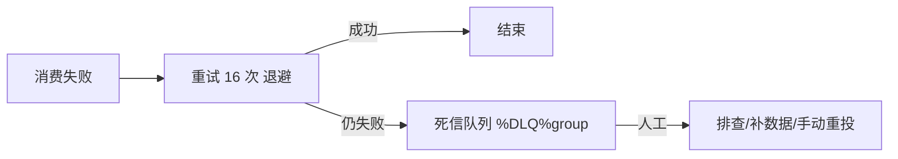

# Day 11：消费重试 + 幂等 + 死信队列

> **班级**：中级班（必学）
> **前置**：Day3 消费返回状态
> **目标**：理解并发消费失败重试与退避；知道死信队列；掌握消费幂等三板斧，能防重复处理。

---

## 一、消费失败会重试（退避）【必学】

并发消费返回 `RECONSUME_LATER`，Broker 会把消息重新投递。默认**最多重试 16 次**，间隔退避（10s → 30s → 1m → 2m … → 2h）。

重试消息进 **`%RETRY%消费组`** 这个内部 Topic，由 Broker 按退避节奏再投给你。

---

## 二、重试耗尽 → 死信队列【必学】

16 次还没消费成功，消息进 **`%DLQ%消费组`** 死信队列，**不再自动重试**，必须人工处理（查原因、补数据、手动重投）。



> 死信不是"消息没了"，是"交给人工"。运维要监控死信队列，不能放任。

---

## 三、为什么必须做幂等【必学】

重试、网络重发，都会让**同一条业务消息被投递多次**。如果消费逻辑是"扣款 100"，重复消费就扣两次。

所以：**消费端必须幂等**——同一条消息处理多次，效果和处理一次一样。

### 幂等三板斧
1. **唯一键去重表**：消费前 `INSERT` 业务主键（订单号+类型），唯一约束挡住重复
2. **Redis SETNX**：`SETNX order:1001:deduct 1`，存在即跳过
3. **业务状态机**：已扣过款（状态=PAID）就直接返回，不重复执行

见 `RetryAndIdempotentService`（用 `Set` 演示去重思路，生产换 DB/Redis）。

---

## 四、实战：扣款消息重复不重复扣【必学】

扣款消费逻辑：先用业务主键（订单号+扣款类型）去重，已处理过直接返回；未处理才执行扣款。这样重试 3 次也只扣 1 次。

---

## 五、代码模板【必学】

- `RetryAndIdempotentService.handle(bizKey)`：返回 true=首次，false=重复
- `DeadLetterService.retryTopic/deadLetterTopic`：命名工具

---

## 六、单元测试 Day11

`Day11RetryIdempotentTest`：同 key 调 3 次 `handle`，断言首次 true、后两次 false、`processedCount()==1`。

```bash
mvn test -Dtest=Day11RetryIdempotentTest
```

---

## 七、核对清单

- [ ] ✅ 知道并发失败默认重试 16 次（退避），进 `%RETRY%group`
- [ ] ✅ 知道耗尽进 `%DLQ%group` 死信，需人工
- [ ] ✅ 能说出幂等三板斧（唯一键 / SETNX / 状态机）
- [ ] ✅ 能写"扣款重复不重复扣"的消费逻辑
- [ ] ✅ Day11 测试绿灯
