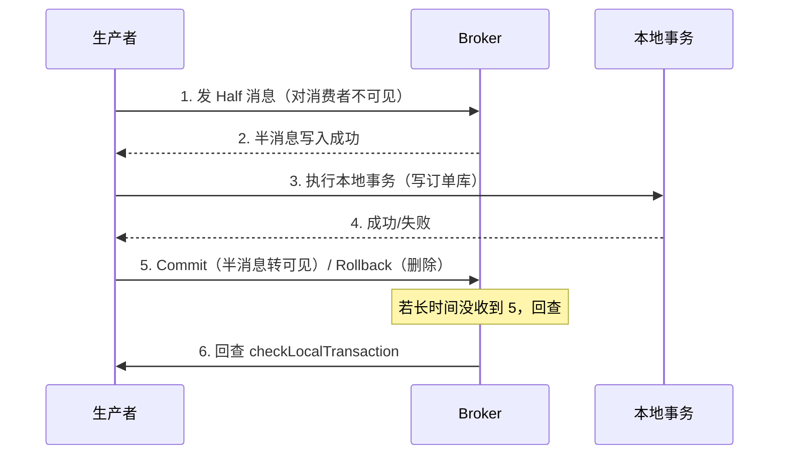

# Day 12：事务消息（Half + 本地事务 + 回查）

> **班级**：高级班（必学）
> **前置**：Day2 发送、Day7 解耦、Day11 幂等
> **目标**：理解事务消息如何解决"本地事务与发消息"的一致性；会用 `TransactionListener` 与回查。

---

## 一、分布式事务的死结【必学】

经典场景：**下单成功后扣库存**（下单在订单库，库存在库存库，两个库）。

```
写订单库 → 发"扣库存"消息 → 提交订单事务
```

问题：如果"写订单库成功，发消息前进程挂了"，消息没发出去，库存没扣 → **数据不一致**。

反过来，先发消息再写库，消息发出去了库写失败 → 库存被下游扣了，订单却没有 → 也不一致。

> 根因：本地事务和"发消息"是两个操作，没法在一个事务里原子完成。

---

## 二、事务消息的解法：Half Message【必学】



Half Message（半消息）：**对消费者不可见**，先落到 Broker。等本地事务执行完，再 `Commit`（半消息变正常，消费者可见）或 `Rollback`（删除半消息）。

这样"消息最终可见"和"本地事务结果"绑定了——本地成，消息才对消费者可见。

---

## 三、回查机制【必学】

如果生产者执行完本地事务、还没来得及发 Commit/Rollback 就挂了，Broker 上的半消息悬着。Broker 会**定时回调** `checkLocalTransaction` 问你："这条本地事务到底成了没？"你按本地事务日志返回 Commit/Rollback。

> 回查是事务消息的兜底：即使生产者崩溃，一致性也能靠回查补完。

---

## 四、代码（TransactionOrderService）【必学】

```java
TransactionMQProducer producer = new TransactionMQProducer(group);
producer.setTransactionListener(new TransactionListener() {
    @Override
    public LocalTransactionState executeLocalTransaction(Message msg, Object arg) {
        // 写订单库（本地事务）
        return localSuccess ? COMMIT_MESSAGE : ROLLBACK_MESSAGE;
    }
    @Override
    public LocalTransactionState checkLocalTransaction(MessageExt msg) {
        // 查本地事务日志，决定最终状态
        return decidedByLocalLog(localLogExists(msg));
    }
});
producer.sendMessageInTransaction(msg, orderId);
```

`decideByLocalLog` 见 `TransactionOrderService`：本地成功→Commit，失败→Rollback。

---

## 五、实战：下单 + 扣库存最终一致【必学】

- `executeLocalTransaction`：写订单库 + 标记"待扣库存"
- 下游库存服务消费到（Commit 后可见）去扣库存
- 若订单库写失败 → Rollback，下游收不到，不扣
- 若 Commit 前崩溃 → 回查按订单库记录补决定

最终：订单和库存要么都成，要么都不动（下游靠 Day11 幂等防重）。

---

## 六、单元测试 Day12

`Day12TransactionTest`：校验 `TransactionListener` 两方法契约 + `decideByLocalLog` 映射。

```bash
mvn test -Dtest=Day12TransactionTest
```

---

## 七、核对清单

- [ ] ✅ 能说清"本地事务 + 发消息"为何难原子
- [ ] ✅ 知道 Half Message 对消费者不可见，Commit 才可见
- [ ] ✅ 知道回查是兜底，生产者崩溃也能补一致性
- [ ] ✅ 能写出 TransactionListener 两个方法
- [ ] ✅ Day12 测试绿灯
