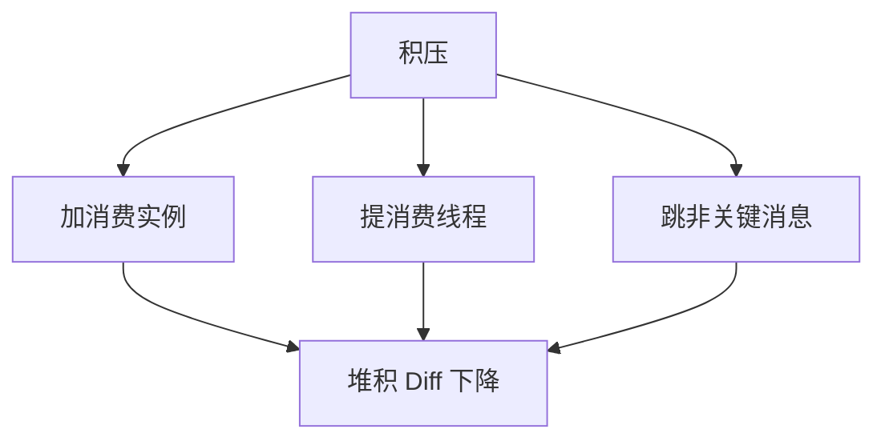

# Day 13：消息积压治理

> **班级**：高级班（必学）
> **前置**：Day6 集群模式、Day11 幂等
> **目标**：能定位积压成因；会用扩容消费实例 / 提线程 / 跳过非关键消息应急；会对消费端限流；知道监控指标。

---

## 一、积压是怎么来的【必学】

```
生产 TPS  >  消费 TPS   →  消息越堆越多
```

三大成因：

| 成因 | 典型场景 |
|:---|:---|
| 消费慢 | 消费逻辑重（查库+调外部接口），单条耗时长 |
| 消费挂 | 消费实例全挂，队列无人拉 |
| 突发流量 | 大促瞬时洪峰，生产者猛发 |

> 看堆积量：`Broker 消息总量 - 消费进度` 的差值（Dashboad 里的 `Diff`）。

---

## 二、应急三板斧【必学】

1. **扩容消费实例**：同组加机器，队列被分摊（Day6 原理）。注意**实例数 ≤ 队列数**才有效（Day3 讲过的并行度）。
2. **提升消费线程数**：`setConsumeThreadMax`，让单实例并发更高（不超过队列数）。
3. **跳过非关键消息**：积压太多、业务允许时，临时跳过非核心消息先清库存，事后补。



---

## 三、消费端限流（防下游被打挂）【必学】

消费快了，下游数据库/接口可能被打挂，反而更慢。用**线程池 + 信号量**限制并发：

```java
Semaphore permits = new Semaphore(20);   // 最多 20 并发访问下游
// 消费时 acquire，处理完 release
```

配 Day11 幂等，跳过/重试都不怕重复。

---

## 四、监控指标【理解】

- **堆积量 Diff**：还有多少没消费，最直观的告警指标
- **消费 TPS**：当前消费速度，判断是否在追平
- **消费延迟**：消息从发到被消费的平均时长

---

## 五、决策辅助（BacklogHandlerService）【必学】

见 `BacklogHandlerService`：`recommendConsumerInstances(积压, 单实例TPS)`、`estimateClearSeconds`、`recommendConsumeThreads(队列数)`——给你"该加多少实例"的量化答案。

---

## 六、单元测试 Day13

`Day13BacklogTest`：100 万积压 / 单实例 2000 TPS → 推荐 500 实例，预计秒级清空；线程数不超过队列数。

```bash
mvn test -Dtest=Day13BacklogTest
```

---

## 七、核对清单

- [ ] ✅ 能说出积压三大成因（慢/挂/突发）
- [ ] ✅ 会用扩容实例 / 提线程 / 跳非关键应急
- [ ] ✅ 知道实例数 ≤ 队列数才有效
- [ ] ✅ 会用信号量给消费端限流保护下游
- [ ] ✅ Day13 测试绿灯
