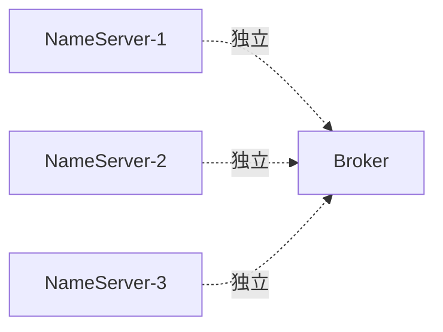
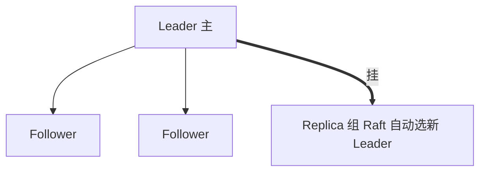

# Day 14：高可用架构【高级标记】

> **班级**：高级班（高级标记）
> **前置**：Day1 四角色、Day12 事务
> **目标**：理解 NameServer 无状态、Broker 主从与刷盘策略的取舍、DLedger 自动切换；能按规模选型部署。

---

## 一、NameServer：无状态路由中心【必学】

- NameServer **互不通信**，各自维护一份路由表（Broker 定期心跳上报）
- 挂掉一个，其余照常工作；客户端缓存路由，已建连的收发不受影响
- 部署建议 **3 个**，无状态好扩



---

## 二、Broker 主从：一致性 vs 性能【必学】

| 维度 | 同步双写（SYNC_MASTER） | 异步复制（ASYNC_MASTER） |
|:---|:---|:---|
| 主写完 | 等从也写完成才返回 | 主写本盘即返回，异步同步给从 |
| 优点 | 主挂从有全量，不丢 | 吞吐高、延迟低 |
| 缺点 | 写入慢（多一跳） | 主挂可能丢少量未同步数据 |

### 刷盘策略（单独维度）
- **SYNC_FLUSH**：消息落盘才返回，**不丢**，慢
- **ASYNC_FLUSH**：写 page cache 即返回，快，宕机可能丢

> 两个维度正交组合：最稳 = 同步双写 + SYNC_FLUSH；最快 = 异步复制 + ASYNC_FLUSH。

---

## 三、DLedger：主挂自动切换【必学】

传统主从的痛点：主挂了，得**人工**把某个从提升为新主，期间服务中断。

DLedger（基于 Raft）是多副本机制：一组 Broker（如 3 副本）选一个 Leader，主挂了 Raft 自动选新 Leader，**秒级切换，不停服**。



> 生产推荐：重要业务用 DLedger 多副本，告别"主挂人工切"。

---

## 四、部署拓扑与选型【必学】

| 规模 | 推荐 | 说明 |
|:---|:---|:---|
| 小团队 / 测试 | 单 Broker + 2~3 NameServer | 省机器，接受丢风险 |
| 中型生产 | 主从（同步双写）+ SYNC_FLUSH + 3 NameServer | 不丢，主挂人工切 |
| 大型 / 不能停 | **DLedger 3 副本** + 3 NameServer | 主挂自动切，近零中断 |

---

## 五、建模辅助（HaDeployService）【必学】

见 `HaDeployService`：`dledgerCluster(n)` / `masterSlave(n)`，算出 NameServer 数、总 Broker 数，用于部署评审。

---

## 六、单元测试 Day14

`Day14HaTest`：断言 DLedger 集群拓扑（3 NameServer、9 Broker、ReplicaMode=DLEDGER）与主从拓扑正确。

```bash
mvn test -Dtest=Day14HaTest
```

---

## 七、核对清单

- [ ] ✅ 知道 NameServer 无状态、互不通信、可多部署
- [ ] ✅ 能说清同步双写 vs 异步复制、SYNC_FLUSH vs ASYNC_FLUSH 的取舍
- [ ] ✅ 知道 DLedger 用 Raft 主挂自动切换，解决人工切
- [ ] ✅ 能按规模给出部署选型
- [ ] ✅ Day14 测试绿灯
