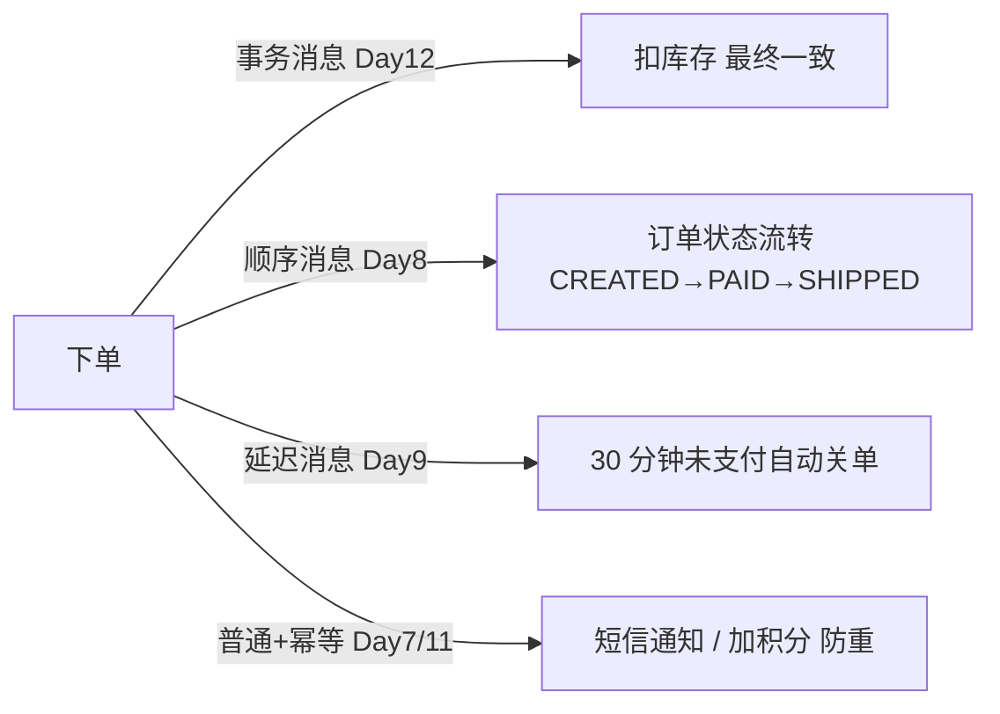

# Day 15：生产最佳实践 + 电商交易链路综合实战

> **班级**：高级班（必学，收官）
> **前置**：Day2~14 全过
> **目标**：串联顺序 / 延迟 / 事务 / 幂等做一条真实交易链路；掌握生产避坑清单；面试高频点串讲。

---

## 一、电商交易链路：把 15 天串起来【必学】

一个下单请求，背后是这样一条消息链路：



- **下单 + 扣库存**：事务消息，最终一致（Day12）
- **订单状态流转**：顺序消息，按 orderId 路由固定队列（Day8）
- **未支付关单**：延迟消息 level 16 = 30 分钟（Day9）
- **短信 / 加积分**：普通消息 + 消费幂等，重复投递不重复处理（Day7 + Day11）

---

## 二、生产避坑清单【必学】

1. **Topic 按业务划分，队列数按并行度定**：别用 Tag 当分类（Day5）；队列数 = 最大并行消费数（Day3/6）
2. **消息大小控制**：单条建议 ≤ 512KB，超大拆文件/落库传 ID；别塞大 JSON
3. **消费必须幂等**：重试/重发必然重复，去重表/SETNX/状态机三选一（Day11）
4. **发送方式按"能不能丢"选**：关键同步、日志单向、高吞吐异步（Day4）
5. **监控堆积 Diff**：Dashboard 盯 Diff/TPS/延迟，积压早告警（Day13）
6. **生产/消费组命名规范**：`group` 见名知意，便于排查与权限
7. **高可用按规模选**：重要业务 DLedger 多副本（Day14）

---

## 三、面试高频串讲【高级标记】

- **消息不丢**：同步双写 + SYNC_FLUSH + 事务消息兜底（Day12/14）
- **不重复**：消费端幂等（Day11）
- **顺序**：分区顺序 + MessageQueueSelector（Day8）
- **积压**：扩容实例 ≤ 队列数 + 限流（Day13）
- **高可用**：NameServer 无状态 + DLedger 自动切换（Day14）

> 一句总纲：**发得对（方式/事务）、收得稳（幂等/限流）、排得顺（顺序/队列）、守得住（高可用/监控）。**

---

## 四、编排层（TradeLinkService）【必学】

见 `TradeLinkService`：`applyScore(orderId, score)` 演示幂等加积分（重复忽略）；`closeOrderDelayLevel()` 返回关单延迟等级 16。把 Day9、Day11 的能力组合进交易链路。

---

## 五、单元测试 Day15

`Day15TradeLinkTest`：同订单加积分首次生效、重复忽略；关单延迟等级 = 16。

```bash
mvn test -Dtest=Day15TradeLinkTest
```

---

## 六、结业核对清单

- [ ] ✅ 能画出"下单→事务扣库存→顺序状态→延迟关单→幂等通知"全链路
- [ ] ✅ 能背生产避坑 7 条
- [ ] ✅ 能串讲面试 5 问（不丢/不重/顺序/积压/高可用）
- [ ] ✅ Day15 测试绿灯
- [ ] ✅ 通过高级班结业 Checkpoint（Day12 事务最终一致 + Day13 积压能恢复）

---

## 结语

15 天，从"发一条收一条"到"电商交易链路生产级"。你已具备用 RocketMQ 扛真实流量的能力。去实战吧。
